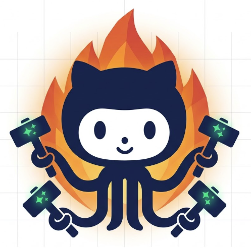

<p align="center">
  
</p>

<h1 align="center">github-forge</h1>

<p align="center"><em>Locally run GitHub Actions using <code>gh</code> and webhooks.</em></p>

---

The forge **subscribes** to a repo's webhooks — it doesn't poll. When something
happens (an issue is opened or assigned, a PR is opened, a comment is posted),
GitHub pushes the event to your machine and the forge runs the job you wired to
it in `forge.yml`. Think of it as GitHub Actions that run on your laptop, with
your tools and your credentials — no CI minutes, no YAML-in-the-cloud.

```
GitHub ──event──▶ gh webhook forward ──POST──▶ forge.js ──▶ the job in forge.yml
```

- **Generic core.** `forge.js` only verifies, routes, and runs. *What* you watch
  and *how* you respond lives in `forge.yml`; the work lives in small `jobs/*.js`.
- **No server, nothing left behind.** `gh webhook forward` creates a temporary
  webhook, tunnels deliveries to localhost, and deletes it when you stop.
- **Minimal.** Node + the `gh` CLI, and one dependency (`js-yaml`).

> **The forge pairs naturally with the [`agents`](#connecting-agents) CLI** —
> let GitHub events drive a fleet of AI coding agents (assign an issue → spin up
> an agent; comment on a PR → message its agent). See below.

## Requirements

- [Node.js](https://nodejs.org) ≥ 18
- The [GitHub CLI](https://cli.github.com) (`gh`), authenticated
- **Admin** on the repo you want to watch (needed to create the webhook)

## Auth

`gh webhook forward` uses your `gh` login to create a short-lived webhook on the
repo, so you need to be authenticated with permission to manage its hooks:

```bash
gh auth login                       # if you haven't already
gh auth status                      # confirm you're logged in
gh auth refresh -h github.com -s admin:repo_hook   # grant hook scope if prompted
gh extension install cli/gh-webhook # the official forwarding extension
```

No tokens or secrets ever live in this repo. Your `gh` credentials stay in `gh`;
the webhook signing secret stays in `.env` (which is gitignored).

## Setup

```bash
git clone https://github.com/mekarpeles/github-forge
cd github-forge
npm install

cp .env.example .env
# edit .env: set FORGE_REPO=OWNER/REPO and a signing secret
#   openssl rand -hex 20   # generate FORGE_SECRET
chmod +x forward.sh
```

> **Prefer to let an agent do it?** This repo ships an [`AGENTS.md`](AGENTS.md).
> Point an AI coding agent (Claude Code, etc.) at this directory and ask it to
> "set up the forge" — it will walk the auth, config, and run steps for you.

## Run it (two terminals)

```bash
# terminal 1 — the forge
set -a; . ./.env; set +a
node forge.js            # or: npm start

# terminal 2 — the forwarder (auto-reconnects on drops)
./forward.sh             # or: npm run forward
```

Do something on the repo and watch terminal 1 light up. With the default
`forge.yml`, every event is appended to `logs/events.jsonl`:

```json
{"at":"…","event":"pull_request","action":"opened","repo":"you/repo","sender":"…","number":42,"title":"…"}
```

## Configuring: `forge.yml`

> [!NOTE]
> **Which events and actions can I use?** Any GitHub webhook event type and its
> actions — the authoritative list is GitHub's
> [Webhook events and payloads](https://docs.github.com/en/webhooks/webhook-events-and-payloads).
> Every event type you reference must also appear in `events:` so the forwarder
> subscribes to it.

This is the whole contract — the events you watch and the jobs they run:

```yaml
repo: ${FORGE_REPO}
events: [issues, pull_request, issue_comment]

routes:
  - on: issues            # bare event: catches every issues action
    run: jobs/log.js
  - on: pull_request.opened   # event.action: more specific, wins over the bare event
    run: jobs/log.js
```

Resolution order for each delivery: an exact `event.action` route, then a bare
`event` route, then the `jobs/<event>.<action>.js` filename convention. Edit
`forge.yml` or any job and the **next event** picks up the change — no restart.

## Writing a job

A job is a file that exports an async function taking a `ctx`:

```js
module.exports = async (ctx) => {
  ctx.log(ctx.event, ctx.action, ctx.repo, ctx.sender);

  // ctx.config is this route's `config:` block from forge.yml
  // ctx.payload is the full webhook body

  // run anything locally:
  const r = await ctx.run('make', ['test']);
  ctx.log('tests exited', r.code);

  // act back on GitHub via gh:
  await ctx.gh(['issue', 'comment', '42', '--repo', ctx.repo, '--body', 'hi']);
};
```

`ctx`: `event`, `action`, `payload`, `config`, `repo`, `sender`, `log(...)`,
`run(cmd, args)`, `gh(args)`.

## Recipes

Common, practical routes live in [`forge.example.yml`](forge.example.yml) with
their jobs in [`examples/`](examples/). Copy what you want into `forge.yml`.

| When…                                    | route(s)                                                        | the trick |
|------------------------------------------|----------------------------------------------------------------|-----------|
| a comment on an issue **or** PR          | `issue_comment.created`                                         | a PR comment carries `issue.pull_request` |
| an issue/PR is opened                    | `issues.opened`, `pull_request.opened`                         | `ctx.event` tells them apart |
| a label is added/removed on an issue/PR  | `issues.labeled`/`unlabeled`, `pull_request.labeled`/`unlabeled` | `ctx.action` = added vs removed; `payload.label` |
| a PR is taken out of draft               | `pull_request.ready_for_review`                                | a dedicated action, no guessing |
| a PR is merged (not just closed)         | `pull_request.closed`                                           | only when `payload.pull_request.merged` is true |
| CI fails on a PR                         | `check_run.completed`                                          | act only when `conclusion === 'failure'` (add `check_run` to `events:`) |

## Tests

```bash
npm test     # node --test, zero extra deps
```

Covers signature verification, route resolution, config/`${ENV}` loading, and an
end-to-end signed delivery through the HTTP server.

## Connecting agents

The forge is a great front end for an AI agent fleet managed with the **`agents`
CLI**. Two example jobs ship in `jobs/` (wire them up in `forge.yml`):

- **`jobs/assign-to-agent.js`** — when an issue is assigned to your bot, spin up
  an agent for it (`agents register … && agents up …`), routed to a lead by label.
- **`jobs/forward-comment.js`** — when an allow-listed teammate comments on a bot
  PR, forward the comment into the agent that owns the PR (`agents send …`),
  resolved by agent metadata (`agents ls --json --meta pr=<N>`).

Both are config-driven and honor `FORGE_DRY_RUN=1` (log what they *would* do
instead of acting) — keep that set until you're happy with the matching.

## Security

- **No secrets in this repo.** `FORGE_SECRET` lives in `.env` (gitignored);
  `gh` holds your GitHub credentials.
- GitHub signs every delivery (`X-Hub-Signature-256`); the forge verifies the
  HMAC before running anything. Empty `FORGE_SECRET` = open dev mode (skip
  verification) — fine for a quick local test, not for anything exposed.
- The server binds to `127.0.0.1` only.
- Jobs run with *your* shell and credentials. Only run jobs you've read.

## Keeping it running

`gh webhook forward` runs only while its process is alive, so for anything
beyond an open terminal, run the two processes under a supervisor that restarts
them and survives logout:

- **tmux** (simplest) — start `node forge.js` and `./forward.sh` in two panes of
  a detached session so they keep running after you disconnect:
  ```bash
  tmux new -d -s forge 'cd ~/github-forge && set -a; . ./.env; set +a; node forge.js'
  tmux new -d -s forward 'cd ~/github-forge && ./forward.sh'
  ```
- **systemd** (Linux, always-on) — two `--user` services (one per process) with
  `Restart=always`, enabled with `loginctl enable-linger` so they start at boot.
- **launchd** (macOS) — two `LaunchAgents` plists with `KeepAlive=true`.

`forward.sh` already auto-reconnects when the websocket drops; the supervisor
covers crashes, reboots, and logout.

For a truly server-side subscription (no long-running local process at all),
create a real webhook pointing at a stable public URL you control and send it to
this same `forge.js` — the dispatch is identical, only the transport changes.

## License

[MIT](LICENSE)
